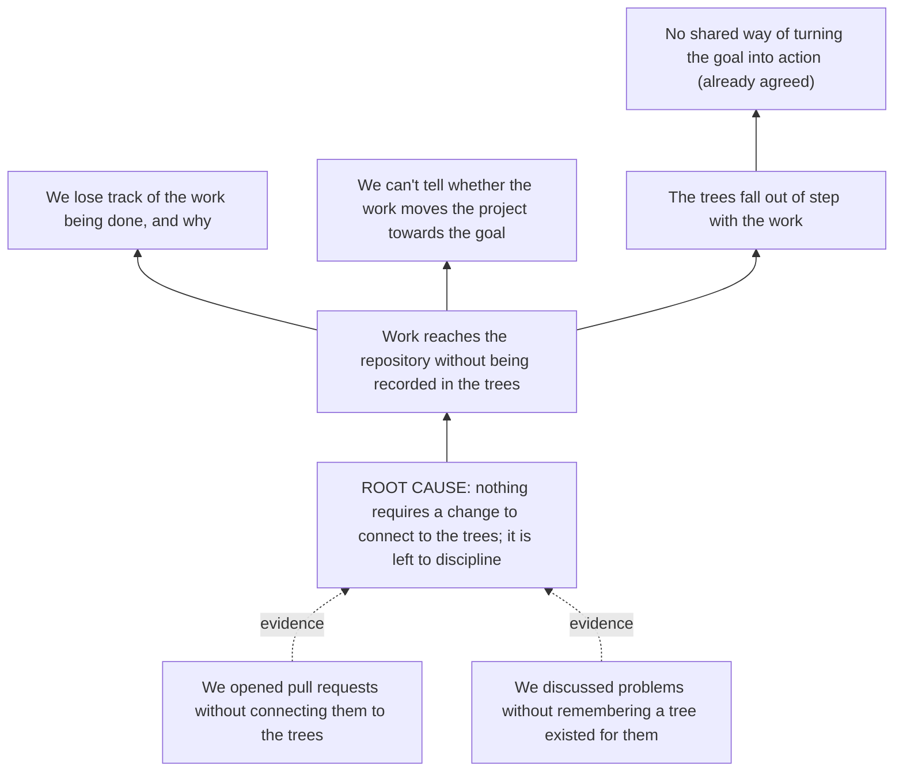
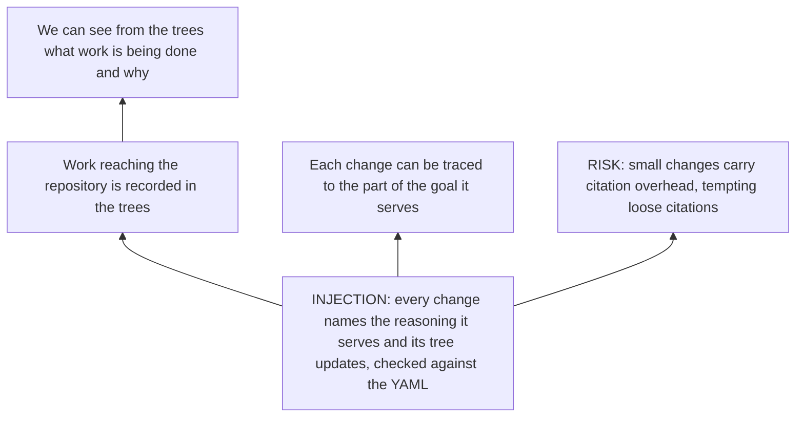

# Making work add up: using Reason Commons on itself

Several months ago, Rufus and I started collaborating on a shared vision: making collaboration itself easier by tackling a particularly elusive bottleneck, which is getting a team's work to add up. To put it less vaguely: how can a group that shares a goal make sure the work its members do stays aligned with that goal?

Our proposed answer borrows from the Thinking Processes of the [Theory of Constraints](/glossary#theory-of-constraints) (TOC), a toolkit usually reached for by consultants and in-the-know managers. The Thinking Processes are a set of diagrams that capture a group's current reasoning about a goal: what's needed to achieve it, which obstacles and conflicts stand in the way, which concrete actions move it forward, and so on.

None of this is new. The Theory of Constraints is more than 40 years old, and reasoning with diagrams is far older still. And yet, for all the value of making reasoning more coherent and easier to follow, diagrammatic reasoning has never really caught on.

Our working hypothesis is that these diagrams have gone unused not because they aren't useful, but because the burden of maintaining them has always fallen on the people whose time and attention are scarcest. The technical architect, the strategy consultant, the CEO: the people whose reasoning most needs to be recorded in a structured form are exactly the people least able to break their flow to record it. Attention is scarcest for those whose reasoning is most valuable to capture.

Generative AI may resolve this conflict between structure and spontaneity. AI can act as a kind of logical clerk, faithfully preserving the structure of the reasoning without asking the people doing it to break their flow.

Reason Commons is an ongoing experiment to test that hypothesis. With the introduction out of the way, I'd like to show how we've learned to use AI to turn our free-flowing, unstructured conversations into disciplined proposals.

## Getting the skill

We've built an AI skill called `reason-commons` that works with Claude Code and Codex. To install it:

```sh
npx skills add life-itself/reasoncommons -s reason-commons
```

The [skills guide](/skills) has the full instructions, including how to try it without installing anything.

## Using Reason Commons on Reason Commons

The skill is meant to help anyone working on a project keep their effort aligned with their goals. Getting a little meta: Reason Commons is itself one of those projects, and a demanding one. If it's going to live up to its promise, it has to work on itself. In the startup world, that's called dogfooding.

The rest of this post walks through one real example, in the order it actually developed: something we noticed, traced back to a cause, turned into a proposed fix, and then shipped in a way you can check for yourself.

### 1. Notice what keeps happening

Rufus and I have been using the Logical Thinking Process to stay focused as we work together, but it still takes discipline, and the discipline slips. We've opened pull requests to fix particular issues without connecting them to our trees at all. We've discussed problems and written them down without remembering that, hey, we have a tree for that. Yet the whole point of the trees is to make sure we're working as effectively as possible, so that every change moves us forward. What gives?

On their own these are just lapses. The tempting response is to resolve to try harder, which is exactly the response that hasn't worked so far. So instead of treating them as the problem, we treated them as evidence and asked what they point to.

### 2. Trace it back to a root cause

Both lapses have the same shape: nothing *requires* a change to the repository to connect to the trees, and therefore to the goal. Making that connection is left entirely to discipline. That's the root cause, and once it's stated, the rest of the chain follows:

- Work reaches the repository without being recorded anywhere in the trees.
- So we, as the project's maintainers, lose track of the work being done and why it was done.
- And we can't tell whether that work moves the project towards the goal, so it risks drifting away from it.
- Meanwhile the trees fall out of step with the work, which feeds a problem we had already agreed on: we have no shared, structured way of turning the goal into action.

In TOC terms, that's a small [Current Reality Tree](/glossary#current-reality-tree): the [undesirable effects](/glossary#undesirable-effect) at the top, the cause underneath them, and the lapses we noticed as the evidence. Read it from the bottom up.



This changes what kind of problem it is. "We should be more disciplined" is a resolution. "Nothing requires the connection" is a design gap, and design gaps can be fixed.

Not every link here is mine. The skill suggested that out-of-step trees feed our existing problem with turning the goal into action, and it recorded that link as its own suggestion, separate from what I said. It also attached an assumption to the "lose track" link: that the trees, not Git history, are where we look to see what work is happening and why. Both are now on our list of things to test.

### 3. Propose an injection aimed at the root cause

An [injection](/glossary#injection), in TOC's vocabulary, is a change intended to remove a cause. Because we'd found the cause, the injection could target it directly: **every change to the repository names the reasoning it serves and the tree updates it makes, and a check confirms those updates against the YAML file that records the trees.**

In practice that means three things:

1. The skill expresses every change it proposes to the project in terms of tree updates, before making the change.
2. A GitHub pull request template asks each pull request which reasoning it serves and which tree updates it makes.
3. An automated check fails a pull request whose stated tree updates don't match its actual changes to the YAML, or which names no reasoning at all.

A [Future Reality Tree](/glossary#future-reality-tree) traces what we expect that to do, including one way it could go wrong. Small changes, such as typo fixes, now carry the overhead of citing some reasoning, and that may tempt people to cite something loosely just to get past the check. TOC calls this a [negative branch](/glossary#negative-branch). Writing it down now means we'll be looking for it.



### 4. Make the change, and let the change prove itself

Here is the part that matters most. A post claiming the principle works is easy to write. What would actually show it is a pull request that obeys the rule it introduces.

That's [the pull request that introduced all of this](https://github.com/life-itself/reasoncommons/pull/58). Its description uses the new template. Under *Reasoning this serves* it cites the part of our existing tree it puts into practice: that Rufus and I run our collaboration through the tree. Under *Tree updates* it lists every node and link it adds, which are the same nodes and links you've just read in the two diagrams above. The new *Tree check* runs on it, compares that list with the pull request's actual changes to [our reasoning file](https://github.com/life-itself/reasoncommons/blob/main/ltp/rufus-david-collab/reason-commons.yaml), and passes. If it hadn't matched, the check would have failed, and you'd be able to see that too.

Everything it adds is still *proposed*. Merging a pull request doesn't make reasoning accepted; Rufus and I accept it by explicitly endorsing it, the same way as everything else in the tree. And one pull request proves very little about whether the injection works. The real test is the next dozen: whether they stay connected to the trees without anyone being reminded, and whether the negative branch shows up. Both of those questions are on the backlog in the same file.

That's the whole loop. A spontaneous observation became evidence, the evidence pointed to a cause, the cause got an injection, and the injection shipped through the very mechanism it describes, with a trail anyone can follow from this post to the pull request, from the pull request to the tree, and from the tree to the goal.
