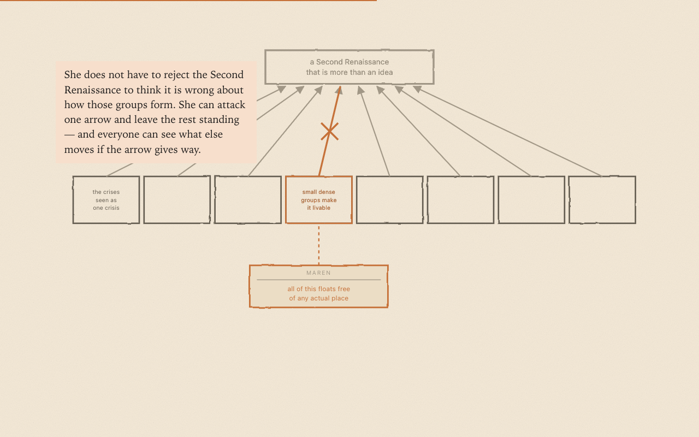

A fourth scrolling explainer, and the first that applies the method to a real
problem rather than an invented clinic. Somebody posts the best paragraph they
have written in a year to the Second Renaissance forum, nine people reply, and a
year later nothing they said has changed what the project believes — not for want
of intelligence or goodwill, but because there is nowhere to put a good thought.
The piece is the case for giving every claim in the project's strategy an address,
and for letting a machine do the filing so that contributing costs one sentence
rather than five diagrams. It is a sibling to the trilogy, not a part four —
someone handed only this link, with no series behind them, still gets a complete
read. Every diagram comes from the group's actual five trees.

An earlier version of this piece, *Whose Map Is It*, retold a single internal
argument about the word "throughput". It was replaced as the way in — it assumed a
reader already inside the trees — but it goes somewhere the accessible version
deliberately does not, so it now stands on its own at
[`explainers/whose-map-is-it/`](../explainers/whose-map-is-it/index.html) as the
deeper cut, linked from the series index and from *Somewhere to Put It*.

All four explainers also had their running text reset — larger, at the size of the
annotations inside the drawings rather than a size below them, and in Literata, so
prose and graphics read as one voice and the page looks the same on every machine
instead of picking a different serif on each.
