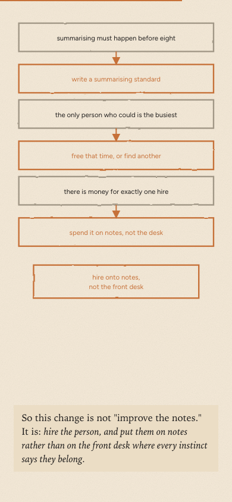

Drove all three explainers in a real browser and fixed what only shows up there —
captions sitting on top of the very thing they were pointing at, boxes falling off
the edge of their own drawing, a chain of arrows that read as a tangle. Parts two and
three now have portrait layouts to match part one, so the diagrams are readable on a
phone instead of shrinking to a ribbon, and the series finally uses the real Organic
colours and Figtree rather than a palette that was merely close.
