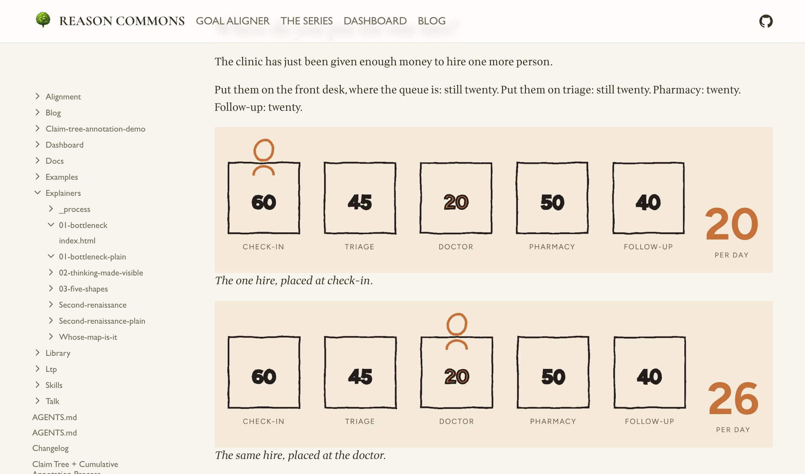

[The Wrong Queue](../explainers/01-bottleneck-plain/) and [The Forum Doesn't Remember](../explainers/second-renaissance-plain/) now each have a plain, non-scrolling companion: the same prose as a classic illustrated essay, with the drawings held still — and the passages that were animations shown as two or three stills side by side. Nothing to scroll-trigger, no JavaScript. They exist to be usability-tested against the scroll-driven originals, which are unchanged; both are linked from [the series index](../explainers/index.html).

The landing page also had a pass — one primary "read the series" call instead of four equal buttons, the "Project LTP" wording dropped from the visitor-facing copy, and the dashboard build-and-serve instructions moved out to [docs/dashboard.md](../docs/dashboard.md).
