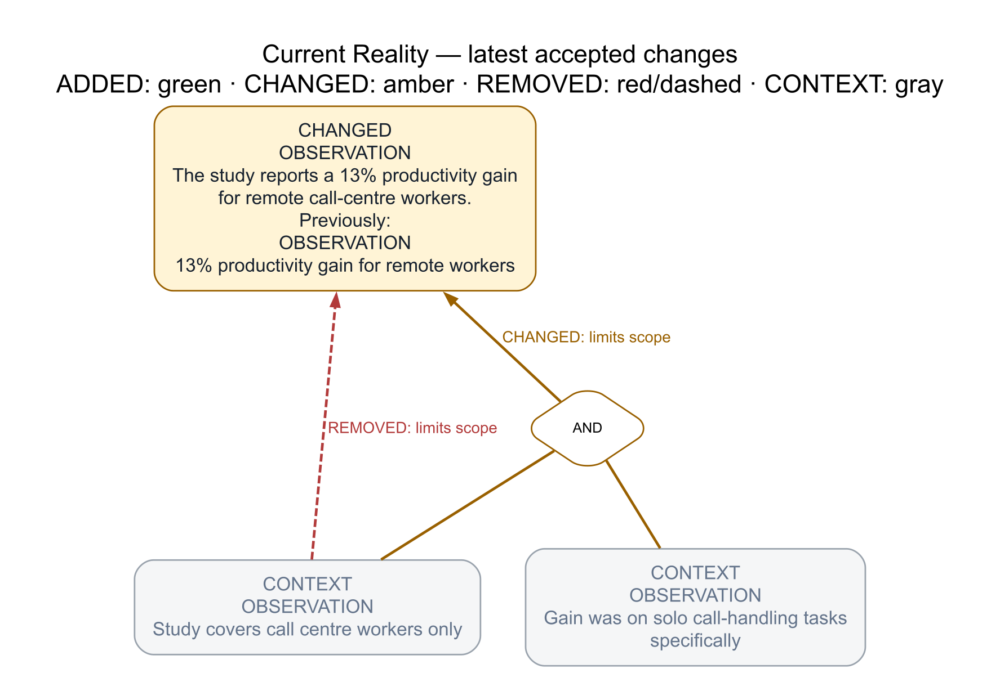

The new [`reason-commons` skill](../skills/reason-commons/SKILL.md) helps individuals and groups develop Thinking Process trees through concise conversations, retaining contributors' ideas and unfinished reasoning. Explicitly accepted changes now preserve a numbered snapshot and produce two diagrams: the accepted tree and its latest changes, with earlier wording and removed connections visible for review.

Sessions offer labeled choices to refine the reasoning, explore difficulties, capture another thought, or view the tree, with a compact status line showing the driver, other participants, and current focus. Tree requests include clearly labeled proposals so the reasoning is visible before anything is accepted. Natural review checkpoints now invite users to test, revise, continue developing, or provisionally accept a coherent proposal.

Collaboration sessions now resume through the existing Beads handoff, with outstanding reasoning linked to work items and task completion kept separate from endorsement.

