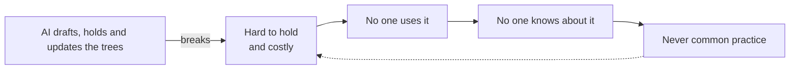

# Brand narrative (draft v1)

Internal. What Reason Commons is trying to say, and in what order. Not site copy: the site, the positioning and the value propositions are derived from this later (plan: [docs/marketing/plans/2026-10-14-brand-and-site-redesign.md](../plans/2026-10-14-brand-and-site-redesign.md)). Built from Rufus's statements of 2026-10-14 and the talk *Where Does Our Thinking Go?*.

## The story in one breath

There is a forty-year-old way of thinking that works — laying out a goal, what blocks it and what to do about it as trees — and almost nobody uses it, because it was too hard to hold in your head and too expensive to buy. So nobody used it, so nobody knew about it, so it never became common practice. AI breaks that loop. It can draft the trees, hold them and keep them current — and, the real leap, grow them out of a group's ordinary conversation, so discussion finally accumulates. That changes how groups think and work together. And it is not just a vision: the first pieces are skills you can install and use today.

## The six ideas in short

Kept as agreed on 2026-10-14; the fuller version follows.

1. **Trees of thought exist, and they work.** Trees of change and trees of action, with LTP as the most rigorous form. Most people have never met them.
2. **They never spread, because of a loop:** hard to hold in your head and costly to buy → nobody used them → nobody knew about them → they never became common practice.
3. **AI breaks the loop.** It drafts the trees, holds them, and keeps them updated.
4. **Trees can grow from discourse.** Ordinary conversation gets annotated onto the tree, so discussion accumulates instead of evaporating.
5. **Two payoffs:** clearer collective thinking, and aligned collaboration within teams.
6. **It's real:** skills you can install and use today.

## The six ideas, and how they connect

The spine is ideas 2 → 3: a loop, and AI breaking it. Idea 4 is the leap that makes this more than "cheaper consulting". Idea 6 is the proof.

1. **Trees of thought exist, and they work.** A tree of change says what we are trying to achieve, what has to be true for it and what is in the way; a tree of action says what we do about it, in what order. Every claim has an address, and the links between claims are claims too, so you can point at one and improve it. The most thorough version comes from Goldratt's Theory of Constraints — developed from the 1970s, published in *The Goal* (1984), with the Thinking Processes growing out of it and codified by Dettmer as the Logical Thinking Process; issue trees and Minto's pyramid are cousins. Most people have never met any of them.
2. **They never spread, because of a loop.** Two barriers kept them inside a few large companies. *Cost*: it took an expert at around $2k a day, so it was used where a $10M factory justified the bill. *Cognitive load*: the method asks you to hold half a dozen linked trees and diagrams, test every cause-and-effect link, and keep them all consistent as things change — a grasp very few people can sustain. So the tools were hard to use → so no one used them → so no one knew about them → so they never became common practice in communities, movements or public discourse, the places that need them most.
3. **AI breaks the loop.** It drafts the trees from what a group already has, holds them consistent and does the updating. People still decide what is accepted. Cost and cognitive load both collapse, so the method can go where it never could.
4. **Trees can grow out of discourse.** The deeper leap. Until now structure had to be added by a person at the moment of contributing — which is why groups faced a dilemma: keep it human, or make it add up. AI removes that assumption. People talk normally, on a forum or in a chat; afterwards the conversation is read against the tree and proposed as annotations — supports this, challenges that — and people decide what merges. Pull requests for discourse. The conversation enriches the tree and the tree gives the conversation somewhere to land.
5. **Two payoffs.** Clearer collective thinking (what is true, what we disagree about, what is missing) and aligned collaboration (what we do, who owns it, why). The tree of change serves the first, the tree of action the second; one follows from the other.
6. **It's real.** There is no app; there is a skill. `reason-commons` runs in Claude Code, Codex and similar agents today: it builds and challenges trees in conversation, keeps who said what, records only what people explicitly accept and draws the result. We use it on our own work. Tools around it (visualisation) exist, and we have prototyped annotating discourse live; Discord integration is next. The earlier Reason Commons app is retired: what we offer is skills and integrations.

The loop is itself a small current reality tree. Telling the brand story as a tree is worth testing: it would show the method rather than describe it.

## The idea map

The structure underneath everything: two pairs, each running both ways. The six ideas tell it as a story; this is the shape behind them.

| | One way | The other way |
|---|---|---|
| **AI and trees** | **AI → trees.** AI makes tree-thinking possible at scale: it breaks the loop of hard, costly, unused, unknown. | **Trees → AI.** Tree-thinking is how humans and AI think and plan *together*: a shared, inspectable structure where AI proposes and people accept. It also tackles AI's "memory" problem — sprawling chat threads and dozens of markdown files that become a morass as a project grows — by giving the work one structure to keep current. |
| **Discourse and trees** | **Discourse → tree.** Ordinary conversation accumulates onto the tree instead of evaporating. | **Tree → discourse.** The tree is a map of the conversation: where we are repeating ourselves, where we already agree, what is missing — "this new thread is about claim X, which we discussed six months ago". |

- **Proof for all four:** the skills. They are also a live instance of *trees → AI*: a person and an AI reasoning together, with an acceptance gate and one saved structure instead of a pile of chats.
- **Status:** AI → trees and trees → AI are true today (the skill). Discourse → tree is prototyped (live annotation). Tree → discourse is specified (the talk) and not yet built.

## What we foreground where

Stage 4 makes the final page choices; this sets the default.

| Surface | Lead idea | Value proposition | Audience |
|---|---|---|---|
| Home | AI → trees | *Keep it human. Make it add up.* — try the skill | Everyone; skill-runners first |
| Home (vision) | Discourse → tree, tree → discourse | Your conversation builds the tree; the tree maps your conversation | Newcomers, stewards |
| Home (secondary block) | Trees → AI | A shared structure for thinking and planning with AI | AI crowd, funders |
| Use it | Trees → AI, AI → trees | Think and plan with AI — and keep what you agree | Facilitators, AI-native builders |
| Vision | Trees → AI | Trees as infrastructure for human–AI reasoning | Funders, AI crowd |
| Communities angle | Tree → discourse | A map of your forum | Community stewards |
| Guides | The method | The real thing, explained properly | LTP practitioners, the curious |

## What we offer

- **Today:** the skills — install, start a conversation, get a tree with attribution and acceptance. Plus guides to the method and an introduction to trees for newcomers.
- **Being built:** tools around the skill (visualisation), and reading discourse (Discord, forums) back into the tree.
- **The aim:** a commons — shared, addressable trees of change and action that a community, organisation or public debate builds on over years, with AI doing the filing and people doing the deciding.

## Guardrails — what we are not saying

- Not "AI decides". AI proposes and files; people accept.
- Not "use a tool instead of talking". The conversation stays a conversation.
- Not an app to sign up for. Say so once, plainly, then show the skill.
- Not LTP jargon up front. Name the method for credibility; never require its vocabulary.
- Not certainty. Trees hold claims open to challenge — the tone asks rather than asserts.

## Calls made (2026-10-17)

1. **One story, not two.** Clearer thinking (tree of change) comes first; aligned action (tree of action) follows from it — "how you should act follows from how you think you should" (the talk).
2. **The line:** *Keep it human. Make it add up.* — the talk's dilemma with the "or" deleted. Under it: *Every claim gets an address.* Reasoning in [positioning.md](positioning.md).
3. **Order of telling:** the dissolved dilemma (true today), the loop as why now, the leap (trees from discourse) as the vision, the skills as proof. The vision may run a little ahead of what has shipped, framed honestly ("we've prototyped…").
4. **History:** anchor on Goldratt's Theory of Constraints — developed from the 1970s, *The Goal* (1984). "Forty years" stands on that basis.
5. **No app.** The app is retired; the offer is skills plus integrations (Discord next).
6. **LTP named once, early, for credibility**; no acronym or tree names until the guides. Practitioners are allies, never "you no longer need a consultant".
7. **"A reason commons" as a common noun:** not yet — revisit when a group has kept one.

## Still open

- Whether the six-idea structure survives contact with the page (stage 4).
- Sourcing for the cost figure (~$2k/day) before it appears on the site.
