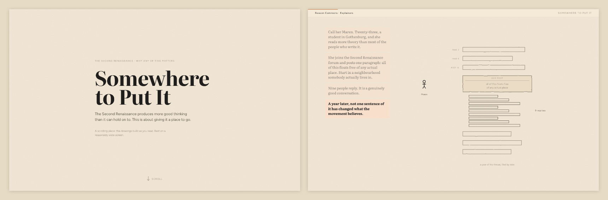

All five scrolling explainers now open on a landing — a title, a scroll cue and a thin bar back to the rest of the site — instead of dropping the reader inside a pinned drawing with no headline and no sign that the page moves. They also respond faster: the second beat of a section used to take a screen and a half of scrolling and now arrives in under half a screen. In [Somewhere to Put It](../explainers/second-renaissance/index.html), Maren's story stacks down the left of the drawing rather than each beat wiping out the last — or start at [The Wrong Queue](../explainers/01-bottleneck/index.html), which is the way into [the series](/explainers).
