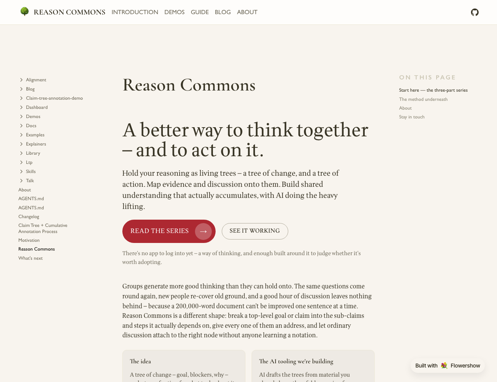

The front page now leads with what the site actually is — a better way to think together and to act on it: trees of change and trees of action, evidence and discussion mapped onto them, with the AI tooling as the bet — and offers two co-equal ways in, [the series](/explainers) and [the demo](../claim-tree-annotation-demo/index.html). The prose that used to fill the page moved into an [About](../about.md) section below the fold. The nav went from `Goal Aligner · The Series · Dashboard · Blog` to `Introduction · Demos · Guide · Blog · About`; Goal Aligner and the other rough pieces are gathered under [Demos](../demos/index.md), and the Logical Thinking Process now has a plain-language [Guide](../ltp/index.md) in front of its analysis documents. Goal Aligner moved from `/alignment/` to `/demos/goal-aligner/`. Design notes: `docs/plans/2026-09-01-site-positioning-and-landing-redesign.md`.
